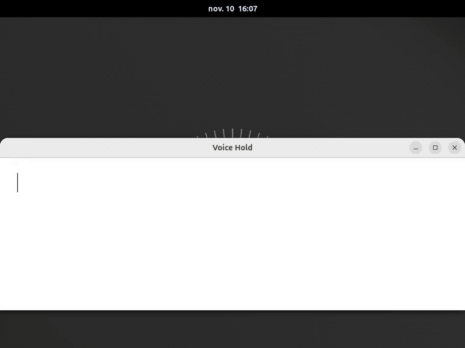

# Voice Hold

**Maintenir une touche, parler, et les mots s'écrivent là où est le
curseur.** La dictée « appuie et parle », pour GNOME, entièrement
hors-ligne.

[English version](README.md)



- **Maintenez `Ctrl+Espace`** et parlez ; relâchez pour arrêter. **Tapez**-le
  brièvement pour dicter mains libres (un second appui, `Échap` ou quelques
  secondes de silence arrêtent).
- Le texte arrive **dans le champ sous le curseur**, bloc par bloc, pendant
  que vous parlez : un aperçu gris en direct, puis chaque phrase est tapée
  pour de bon.
- Une pastille glisse hors de la barre du haut pendant la dictée, avec le
  niveau du micro et les mots, et y rentre quand vous arrêtez. Toujours au
  même endroit ; elle peut aussi suivre le curseur de texte (réglages).
- **Hors-ligne.** Français, anglais et 23 autres langues européennes, avec
  ponctuation et majuscules, reconnus sur votre processeur par Parakeet TDT
  0.6B v3 (via sherpa-onnx). Ni compte, ni réseau, ni cloud. Ça marche dans
  l'avion.
- Dites *nouvelle ligne* / *à la ligne* / *nouveau paragraphe* pour un saut
  de ligne : seul, ou en fin de phrase (« à demain, nouvelle ligne »). Au
  milieu d'une phrase, ça reste du texte (« il a une nouvelle ligne de
  vêtements »).
- En option : un LLM local (Ollama) peut polir chaque bloc. Éteint par
  défaut.
- Rien ne tourne quand vous ne dictez pas ; le modèle quitte la mémoire après
  5 minutes d'inactivité.

Deuxième membre de la famille *Hold* après
[Accent Hold](https://github.com/d101c/accent-hold).

## Installation

Deux parties : le moteur (un petit programme Python) et l'extension.

```bash
pipx install git+https://github.com/d101c/voice-hold#subdirectory=engine
voice-hold-engine setup
```

`setup` télécharge les modèles (~470 Mo, 650 Mo décompressés, une fois ;
chaque fichier est vérifié contre une empreinte SHA-256 épinglée) et
enregistre le moteur comme service D-Bus que GNOME Shell lance à la
demande. `uv tool install` marche aussi. Nécessite Python ≥ 3.12 et PipeWire
(tout GNOME récent).

Puis l'extension depuis extensions.gnome.org (bientôt), ou depuis les
sources :

```bash
git clone https://github.com/d101c/voice-hold && cd voice-hold
./pack.sh && gnome-extensions install --force voice-hold@griffit.gmail.com.shell-extension.zip
```

Déconnectez-vous puis reconnectez-vous (Wayland), activez *Voice Hold*,
cliquez dans un champ texte, maintenez `Ctrl+Espace` et parlez.

Voix facultatives, pour les autres programmes qui veulent faire parler le moteur :

```bash
voice-hold-engine setup --tts        # français et anglais (~65 Mo chacune), ou : --tts fr
voice-hold-engine speak "Bonjour"    # une vérification rapide
```

Ce sont des voix [Piper](https://github.com/rhasspy/piper) (fr_FR-siwis,
en_US-lessac) exécutées par sherpa-onnx et jouées par PipeWire ; une phrase
est synthétisée en quelques centaines de millisecondes sur un processeur de
portable. Le moteur épingle sherpa-onnx sous la 2.0, qui a retiré le
frontal espeak-ng dont ces voix ont besoin.

## Prérequis et limites

- GNOME Shell 45 à 51 sous Wayland.
- Fonctionne dans les applications qui utilisent le protocole Wayland
  text-input (GTK 4, GTK 3, Qt, Electron en Wayland, Firefox…). Les
  terminaux reçoivent les blocs finaux mais pas l'aperçu gris. Les
  applications X11 ne sont pas prises en charge.
- Processeur seulement. Sur un portable quatre cœurs de 2019, une phrase de
  5 secondes est tapée environ une demi-seconde après la pause ; le modèle
  occupe ~1,1 Go de RAM quand il est chargé et met ~5 s à se charger la
  première fois.

## Désinstaller, mettre à jour

```bash
voice-hold-engine uninstall --models   # retire le fichier de service D-Bus et les modèles
pipx uninstall voice-hold-engine       # ou : uv tool uninstall voice-hold-engine
```

Sans `--models`, les modèles restent (`~/.local/share/voice-hold/models`).
Pour mettre le moteur à jour, `pipx reinstall voice-hold-engine` (ou `pipx
install --force git+…`) suffit : le fichier de service pointe vers
l'interpréteur de l'environnement pipx, dont le chemin ne change pas.
`voice-hold-engine status --verify` contrôle les fichiers de modèle contre
leurs empreintes.

## Réglages

Raccourci, geste (maintien / appui / les deux), seuil d'appui, délai de
silence, polissage Ollama facultatif (modèle, URL), pastille (affichée ou
non, sous la barre du haut ou à côté du curseur de texte) et indicateur de
barre supérieure. La page de réglages montre aussi l'état du moteur et la
commande d'installation. La méthode `Speak` du moteur (texte, langue) est à
la disposition des autres programmes du bus de session ;
`voice-hold-engine status` liste les voix installées.

## Sécurité

Le moteur est un service D-Bus de session (`org.griffit.VoiceHold`), comme
tout service utilisateur : chaque processus de votre session peut l'appeler
et lire ses signaux, avec vos propres droits. Le moteur n'écrit rien sur le
disque et rien ne quitte la machine, mais un autre processus local pourrait
lancer une dictée ou lire le texte reconnu ; le bus de session n'offre pas
de contrôle d'accès plus fin.

## Transparence

Écrit avec un assistant de code IA (Claude), conçu, relu et testé à la main
par l'auteur, qui le maintient.

## Licences

Voice Hold (extension et moteur) est sous **GPL-2.0-or-later** : le texte de
la GPLv2 est dans [LICENSE](LICENSE) et [engine/LICENSE](engine/LICENSE),
et toute version ultérieure est permise. Ce « ou ultérieure » compte : le
moteur utilise sherpa-onnx, sous Apache-2.0, compatible avec la GPLv3 mais
pas avec la GPLv2 seule ; l'ensemble est distribué aux conditions de la
GPLv3.

Composants du moteur : Parakeet TDT 0.6B v3 (NVIDIA, CC-BY-4.0, téléchargé
par vous à `setup`, non redistribué ici), Silero VAD (MIT, idem),
sherpa-onnx (Apache-2.0), onnxruntime (MIT), dbus-fast (MIT), numpy
(BSD-3-Clause). Les modèles viennent de la release `asr-models` de
sherpa-onnx et sont vérifiés contre des empreintes SHA-256 épinglées dans
`engine/src/voice_hold_engine/models.py`. Le fichier
`engine/tests/data/cafe.wav` est une phrase synthétisée avec Piper et
enregistrée par nous : aucune voix réelle.
