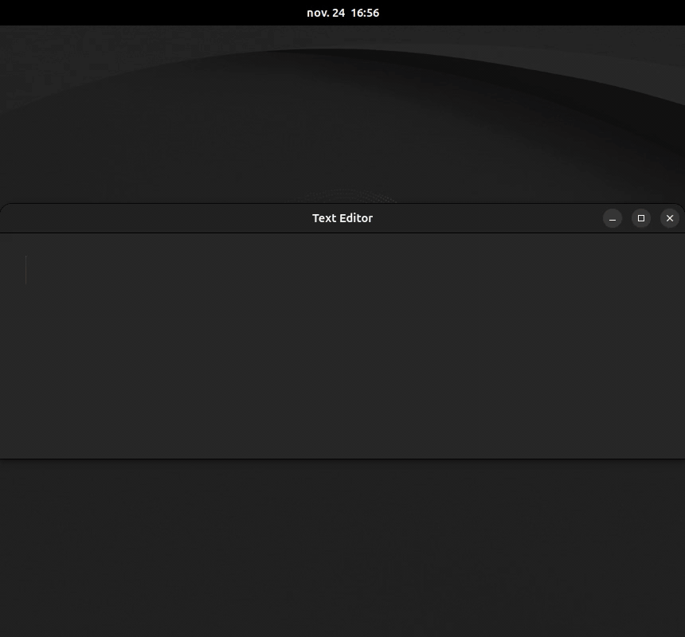

# Voice Hold

**Hold a key, speak, and the words appear where your cursor is.**
Press-and-hold dictation for GNOME, fully offline.

[Version française](README.fr.md)



- **Hold `Ctrl+Space`** and talk; release to stop. **Tap** it instead to dictate
  hands-free (tap again, `Esc`, or a few seconds of silence stop it).
- Or say the **wake word** (optional, off by default; *"Hé Kodiak"* unless you
  choose another): a hands-free dictation starts without touching the keyboard. The word is recognised on your
  computer; listening pauses while the screen is locked or another
  application records.
- The text lands **in the field under your cursor**, block by block, while
  you speak: a grey live preview, then each phrase is typed for good. In
  applications that do not take dictated text directly (many Electron apps),
  it is pasted at the end and stays in the clipboard.
- A pill floats at the bottom of the screen, above the dock, with the
  microphone level and the words. It can hang from the top bar or follow the
  text cursor instead (settings). Short sounds mark the start and the end;
  music and videos pause, or are turned down, while you speak. Change window
  while you dictate and the words follow your cursor.
- **Offline.** French, English and 23 other European languages, with
  punctuation and capitals, recognised on your CPU by Parakeet TDT 0.6B
  "Ultra" (via sherpa-onnx). No account, no network, no cloud. It works on a plane.
- Spoken commands: *nouvelle ligne* / *new line* / *new paragraph*;
  self-corrections (*"at 2, no, I mean 3"* gives *"at 3"*, *"scratch that"*
  drops the sentence); lists (*"firstly… secondly…"*).
- **Your vocabulary:** names and jargon written your way, and replacements
  (*"my address"* becomes the full address). Retype a word just after a
  dictation and its spelling is learned by itself.
- **Clean-up**, your choice: the rules alone (instant), a language model on
  your computer, or a fast cloud model with your own key.
- **Usage:** how many words you dictated and the time it saved you, counted
  on your computer, numbers only.
- **Modes** per kind of application (email, chat, code, other): as said,
  clean message, email, notes or your own instruction. A mode has a language
  model rewrite the whole text: the local one, or a cloud model if you switch
  it on (only the text is sent; your voice never leaves the computer).
- Optional: **voice commands**, off by default (settings, *Commands* page).
  A second shortcut (Ctrl+Alt+Space): hold it, say what to do, release. Opening an
  application, the volume, dark mode, a workspace… are done at once; a
  shell command is shown first and only runs once you confirm it. With text
  selected, what you say rewrites it (*"shorter"*, *"in English"*). Requests
  the rules do not know go to a small language model that the engine runs
  on your computer (llama.cpp), a separate download
  (`voice-hold-engine setup --commands`, or the Install button of that page).
- History of the last dictations, on your computer only (off by default),
  and *Paste the last dictation* in the top bar menu.
- Nothing runs when you are not dictating (unless the wake word is on); the
  model leaves memory after a few minutes of inactivity.

Second member of the *Hold* family after
[Accent Hold](https://github.com/d101c/accent-hold).

## Install

**The easy way, no terminal:** install the extension, then press `Ctrl`+`Space`
(or the *Install* button of the notification). The settings open on an
*Installation* page: one *Install* button downloads the speech engine and its
models (about 500 MB) into your home folder, and a field lets you try the
dictation right there.

**By hand:** two parts, the engine (a small Python program) and the extension.

```bash
pipx install git+https://github.com/d101c/voice-hold#subdirectory=engine
voice-hold-engine setup
```

`setup` downloads the models (~470 MB, 650 MB unpacked, once; every file is
checked against a pinned SHA-256) and registers the engine as a D-Bus
service that GNOME Shell starts on demand. `uv tool install` works too.
Needs Python ≥ 3.12 and PipeWire (any recent GNOME).

Then install the extension from extensions.gnome.org (soon), or from source:

```bash
git clone https://github.com/d101c/voice-hold && cd voice-hold
./pack.sh && gnome-extensions install --force voice-hold@griffit.gmail.com.shell-extension.zip
```

Log out and back in (Wayland), enable *Voice Hold*, click in a text field,
hold `Ctrl+Space` and speak.

Optional voices, for other programs that want the engine to speak:

```bash
voice-hold-engine setup --tts        # French and English (~65 MB each), or: --tts fr
voice-hold-engine speak "Bonjour"    # a quick check
```

They are [Piper](https://github.com/rhasspy/piper) voices (fr_FR-siwis,
en_US-lessac) run by sherpa-onnx and played through PipeWire; a sentence is
synthesised in a few hundred milliseconds on a laptop CPU. The engine pins
sherpa-onnx below 2.0, which dropped the espeak-ng front end these voices need.

## Requirements and limits

- GNOME Shell 45 – 51 on Wayland.
- Works in applications that use the Wayland text-input protocol (GTK 4,
  GTK 3, Qt, Electron with Wayland, Firefox…). Terminals get the final
  blocks but not the grey preview. X11 applications are not supported.
- CPU only. On a 2019 quad-core laptop a 5-second phrase is typed about
  half a second after you pause; the model takes ~1.1 GB of RAM while
  loaded and ~5 s to load the first time.

## Uninstall, update

```bash
voice-hold-engine uninstall --models   # removes the D-Bus service file and the models
pipx uninstall voice-hold-engine       # or: uv tool uninstall voice-hold-engine
```

Without `--models` the models stay (`~/.local/share/voice-hold/models`).
To update the engine, `pipx reinstall voice-hold-engine` (or `pipx install
--force git+…`) is enough: the service file points at the interpreter of
the pipx environment, whose path does not change. `voice-hold-engine status
--verify` checks the model files against their pinned checksums.

## Settings

Shortcut, gesture (hold / tap / both), tap threshold, silence timeout, wake
word, sounds, music pause, text clean-up (hesitations, self-corrections,
optional polish by the local LLM), vocabulary and replacements, modes per
application, history, pill (on or off; at the bottom, under the top bar or
next to the text cursor) and top-bar indicator. The settings page also shows
the engine status and the install command. The engine's `Speak` method
(text, language) is there for other programs on the session bus;
`voice-hold-engine status` lists the installed voices.

## How it works

The extension hooks GNOME Shell's input method (`Main.inputMethod`), the
same object Accent Hold uses: live text goes in as *preedit* (the
application underlines it), finished blocks are *committed*. The engine
captures the microphone with `pw-record`, cuts speech at pauses with the
Silero voice activity detector, decodes each finished segment with Parakeet
and, while you are still speaking, re-decodes the current segment every
~0.8 s for the preview. See
[docs/superpowers/specs/2026-11-02-voice-hold-design.md](docs/superpowers/specs/2026-11-02-voice-hold-design.md).

The engine is a session D-Bus service (`org.griffit.VoiceHold`), like any
other user service: every process of your session can call it and read its
signals, with your own privileges. Nothing is written to disk by the engine
and nothing leaves the machine, but another local process could start a
dictation or read the recognised text; the session bus has no finer access
control than that.

## Development

```bash
for t in extension/tests/*.test.js; do gjs -m "$t"; done
cd engine && uv venv && uv pip install -e '.[test]' && .venv/bin/pytest
tools/headless/run.sh            # end-to-end in a headless GNOME Shell, with a WAV
```

`engine/tests/data/cafe.wav` is a sentence synthesised with Piper
(text-to-speech) and recorded by us for the tests and the demo; it contains
no one's voice.

## Roadmap and issues

Bugs, ideas, planned work and things still to test are tracked in the
[GitHub issues](https://github.com/d101c/voice-hold/issues); what is planned for
the next version is grouped in a milestone.

- **Report a bug:** open an issue with your distribution, GNOME Shell version,
  what you did, what you expected and what happened, plus any error shown by
  `journalctl -b /usr/bin/gnome-shell`.
- **Suggest an idea:** open an issue that describes what you want to do.

## Transparency

Written with an AI coding assistant (Claude), designed, reviewed and tested
by hand by the author, who maintains it.

## Licences

Voice Hold (extension and engine) is **GPL-2.0-or-later**: the GPLv2 text
is in [LICENSE](LICENSE) and [engine/LICENSE](engine/LICENSE), and you may
use any later version. The "or later" matters: the engine links sherpa-onnx,
which is Apache-2.0, a licence compatible with GPLv3 but not with GPLv2
alone; the combination is distributed under the terms of GPLv3.

What the engine uses:

| Component | Licence | Notes |
|---|---|---|
| [Parakeet Ultra](https://huggingface.co/moondream/parakeet-ultra) (int8 export by sherpa-onnx) | CC-BY-4.0, Moondream, post-trained from NVIDIA's [Parakeet TDT 0.6B v3](https://huggingface.co/nvidia/parakeet-tdt-0.6b-v3) | Downloaded by you at `setup` from the sherpa-onnx releases; not redistributed here. Attribution: Moondream, NVIDIA NeMo. |
| Kroko French streaming zipformer (`sherpa-onnx-streaming-zipformer-fr-kroko-2025-08-06`) | CC-BY-SA-4.0, Banafo (Kroko ASR) | Optional, wake word: downloaded by the engine the first time the wake word is switched on (or `setup --wake`); not redistributed here. |
| [llama.cpp](https://github.com/ggml-org/llama.cpp) (release b12284) | MIT | Optional, voice commands and polish: the server binary is downloaded by you at `setup --commands`; not redistributed here. |
| [Qwen3.5-2B](https://huggingface.co/unsloth/Qwen3.5-2B-GGUF) (Q4_K_M GGUF) | Apache-2.0, Alibaba Cloud | Optional, same download; not redistributed here. |
| [Silero VAD](https://github.com/snakers4/silero-vad) | MIT | Downloaded by you at `setup`; not redistributed here. |
| [sherpa-onnx](https://github.com/k2-fsa/sherpa-onnx) | Apache-2.0 | Speech recognition and VAD runtime. |
| [onnxruntime](https://github.com/microsoft/onnxruntime) | MIT | Through sherpa-onnx. |
| [dbus-fast](https://github.com/Bluetooth-Devices/dbus-fast) | MIT | D-Bus. |
| [numpy](https://numpy.org) | BSD-3-Clause | Audio buffers. |

The model files are fetched from the `asr-models` release of sherpa-onnx
and verified against SHA-256 checksums pinned in `engine/src/voice_hold_engine/models.py`
(taken from the GitHub release digests and confirmed by a download on
2026-11-03).
