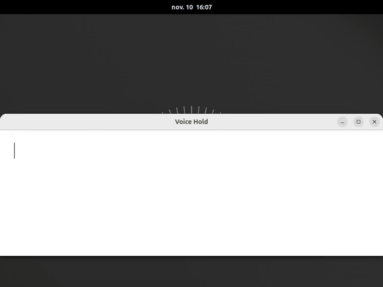

# Voice Hold

**Hold a key, speak, and the words appear where your cursor is.** The macOS
press-and-hold dictation, for GNOME, fully offline.

[Version française](README.fr.md)



- **Hold `Super+R`** and talk; release to stop. **Tap** it instead to dictate
  hands-free (tap again, `Esc`, or a few seconds of silence stop it).
- The text lands **in the field under your cursor**, block by block, while
  you speak: a grey live preview, then each phrase is typed for good.
- A dark pill next to the cursor shows the microphone level and the words.
- **Offline.** French, English and 23 other European languages, with
  punctuation and capitals, recognised on your CPU by Parakeet TDT 0.6B v3
  (via sherpa-onnx). No account, no network, no cloud. It works on a plane.
- Say *nouvelle ligne* / *new line* / *new paragraph* for a line break.
- Optional: a local LLM (Ollama) can polish each block. Off by default.
- Nothing runs when you are not dictating; the model leaves memory after
  5 minutes of inactivity.

Second member of the *Hold* family after
[Accent Hold](https://github.com/d101c/accent-hold).

## Install

Two parts: the engine (a small Python program) and the extension.

```bash
pipx install git+https://github.com/d101c/voice-hold#subdirectory=engine
voice-hold-engine setup
```

`setup` downloads the models (~650 MB, once) and registers the engine as a
D-Bus service that GNOME Shell starts on demand. `uv tool install` works
too. Needs Python ≥ 3.12 and PipeWire (any recent GNOME).

Then install the extension from extensions.gnome.org (soon), or from source:

```bash
git clone https://github.com/d101c/voice-hold && cd voice-hold
./pack.sh && gnome-extensions install --force voice-hold@griffit.gmail.com.shell-extension.zip
```

Log out and back in (Wayland), enable *Voice Hold*, click in a text field,
hold `Super+R` and speak.

## Requirements and limits

- GNOME Shell 45 – 50 on Wayland.
- Works in applications that use the Wayland text-input protocol (GTK 4,
  GTK 3, Qt, Electron with Wayland, Firefox…). Terminals get the final
  blocks but not the grey preview. X11 applications are not supported.
- CPU only. On a 2019 quad-core laptop a 5-second phrase is typed about
  half a second after you pause; the model takes ~1.1 GB of RAM while
  loaded and ~5 s to load the first time.

## Settings

Shortcut, gesture (hold / tap / both), tap threshold, silence timeout,
optional Ollama polish (model, URL), pill and top-bar indicator. The settings
page also shows the engine status and the install command.

## How it works

The extension hooks GNOME Shell's input method (`Main.inputMethod`), the
same object Accent Hold uses: live text goes in as *preedit* (the
application underlines it), finished blocks are *committed*. The engine
captures the microphone with `pw-record`, cuts speech at pauses with the
Silero voice activity detector, decodes each finished segment with Parakeet
and, while you are still speaking, re-decodes the current segment every
~0.8 s for the preview. See
[docs/superpowers/specs/2026-11-02-voice-hold-design.md](docs/superpowers/specs/2026-11-02-voice-hold-design.md).

## Development

```bash
gjs -m extension/tests/holdMachine.test.js
gjs -m extension/tests/textSink.test.js
cd engine && uv venv && uv pip install -e '.[test]' && .venv/bin/pytest
tools/headless/run.sh            # end-to-end in a headless GNOME Shell, with a WAV
```

## Transparency

Written with an AI coding assistant (Claude), designed, reviewed and tested
by hand by the author, who maintains it.

## License

GPL-2.0-or-later.
